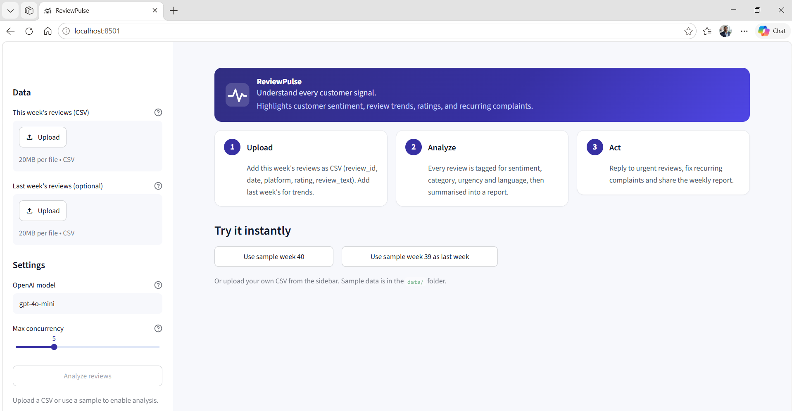
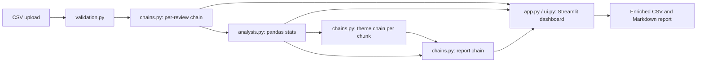

# ReviewPulse

> **Understand every customer signal.**

ReviewPulse highlights customer sentiment, review trends, ratings, and recurring complaints. Upload a CSV of customer reviews (English, Tamil or Tanglish) and get every review tagged, a dashboard, a weekly insights report and an Excel-ready enriched CSV.

## 📌 Overview

Businesses that receive hundreds of reviews a week from platforms such as Google, Zomato, Swiggy and Amazon usually read them by hand. Urgent complaints are missed and nobody can say with numbers what customers complain about most.

ReviewPulse runs each review through a LangChain chain that returns a fixed, validated structure, then computes all statistics in pandas and has the LLM write only the narrative parts of the weekly report. The LLM never calculates counts or percentages.

## ✨ Features

- CSV upload with validation (required columns, empty rows, duplicate IDs, bad dates and ratings)
- Per-review structured analysis: `sentiment`, `category`, `urgency`, `language`, one-line English `summary`, `suggested_reply`
- Tamil and Tanglish reviews summarised in English; suggested replies written in the same language and style as the review
- Automatic retry (2 retries) on invalid LLM output, then the row is marked `needs review`
- Weekly insights report (top complaints, top praise, 3 action items, urgent note) built map-reduce style
- Streamlit dashboard with five tabs: Overview, Trends, Recurring complaints, Weekly report, Reviews
- Optional last-week CSV for week-over-week trend arrows and KPI deltas
- HIGH-urgency filter, plus filters on sentiment, category, platform, language and text search
- Weekly report download as Markdown; enriched table download as UTF-8 (with BOM) CSV for Excel
- Built-in sample buttons on the landing page for trying the app without uploading data

## 🎥 Demo



`[ADD DEMO VIDEO HERE]`

## 🏗️ Architecture



| Component | Role |
|---|---|
| `validation.py` | Checks columns, drops empty rows, duplicates and rows without text, cleans dates and ratings |
| `chains.py` | LCEL chains (`ChatPromptTemplate` piped into `ChatOpenAI.with_structured_output(...)`), batching, retry logic, map-reduce report |
| `schemas.py` | Pydantic models and the allowed values for sentiment, category and urgency |
| `analysis.py` | All counts, percentages, trends and aggregates in pandas, plus the Excel-friendly CSV export |
| `ui.py` | Design tokens, CSS, header, KPI cards and Plotly charts |
| `app.py` | Streamlit app and session-state caching of results |

## 🔄 How It Works

1. **Upload**: the user uploads this week's CSV (and optionally last week's), or uses a sample button.
2. **Validate**: required columns are checked and unusable rows are dropped.
3. **Classify**: the per-review chain runs with `chain.batch` and `max_concurrency` (default 5). Invalid outputs fail Pydantic validation, are retried up to 2 times, then marked `needs review`.
4. **Aggregate**: pandas computes sentiment, category and urgency counts, rating distribution, sentiment over time, platform breakdown, recurring complaints and week-over-week trends.
5. **Report**: summaries are split into chunks of 40; a theme chain runs per chunk (map) and one report chain combines the themes with the pandas statistics (reduce).
6. **Show and export**: the dashboard renders results; filters do not re-call the LLM because results are cached in `st.session_state`.

## 🛠️ Tech Stack

| Category | Technology |
|---|---|
| Language | Python |
| LLM framework | LangChain (`langchain-core`, `langchain-openai`) |
| LLM | OpenAI via `ChatOpenAI`; model set by `OPENAI_MODEL` (default `gpt-4o-mini`) |
| Validation | Pydantic v2 |
| Data | pandas |
| UI | Streamlit, Plotly |
| Configuration | python-dotenv |
| Testing | pytest |

## 📁 Project Structure

```text
reviewpulse/
├── .streamlit/
│   └── config.toml          # light theme, minimal toolbar, 20 MB upload cap
├── data/
│   ├── reviews_week39.csv   # 90 sample reviews (prior week)
│   └── reviews_week40.csv   # 220 sample reviews
├── tests/
│   ├── test_app.py          # Streamlit AppTest smoke tests
│   └── test_core.py         # validation, pandas and chain-logic tests
├── analysis.py
├── app.py
├── chains.py
├── generate_sample_data.py
├── schemas.py
├── ui.py
├── validation.py
├── requirements.txt
├── .env.example
└── README.md
```

## ⚙️ Prerequisites

- **Required:** Python 3 (developed on 3.11), an OpenAI API key
- **Optional:** a virtual environment (recommended)

## 🚀 Installation

```bash
git clone https://github.com/dineshpec/ReviewPulse.git
cd ReviewPulse
python -m venv .venv

# Windows
.venv\Scripts\activate
# Linux/macOS
source .venv/bin/activate

pip install -r requirements.txt
```

## 🔐 Configuration

Copy the example file and add your key. Never commit `.env`.

```bash
# Windows
copy .env.example .env
# Linux/macOS
cp .env.example .env
```

| Variable | Required | Description | Example |
|---|---|---|---|
| `OPENAI_API_KEY` | Yes | OpenAI API key, read from `.env` or the environment only | `your-key-here` |
| `OPENAI_MODEL` | No | Chat model name; defaults to `gpt-4o-mini` | `gpt-4o-mini` |

## ▶️ Running the Application

```bash
streamlit run app.py
```

Streamlit prints the local URL (by default `http://localhost:8501`).

To regenerate the sample CSVs:

```bash
python generate_sample_data.py
```

## 💻 Usage

1. Upload `data/reviews_week40.csv` (or click **Use sample week 40**).
2. Optionally upload `data/reviews_week39.csv` as last week (or click **Use sample week 39 as last week**) to get trend arrows.
3. Click **Analyze reviews**.
4. Explore the tabs, filter to HIGH urgency, and download the enriched CSV or the Markdown report.

**Input CSV columns:** `review_id`, `date`, `platform`, `rating`, `review_text`.

```csv
review_id,date,platform,rating,review_text
R-1042,2026-10-03,Swiggy,1,"Ordered at 8pm, came at 9:10. Food fully cold. Very bad."
```

**Allowed values per review:**

| Field | Values |
|---|---|
| `sentiment` | `positive`, `neutral`, `negative` |
| `category` | `food_quality`, `delivery`, `price`, `staff`, `packaging`, `app` |
| `urgency` | `low`, `medium`, `high` (high = reply today: health, refund, abuse, wrong order, rude staff) |

## 🤖 AI Details

### Implemented

- Structured output through Pydantic models and `with_structured_output()`
- Batched LLM calls with `max_concurrency`
- Retry then `needs review` fallback for invalid output
- Map-reduce weekly report: theme extraction per chunk, then one reduce step fed with pandas statistics
- Prompts instruct the LLM not to recompute numbers; all figures come from pandas
- Replies in the review's own language and script

### Not implemented

RAG, agents, tool calling, memory, reranking and any evaluation of LLM output quality are not part of this project.

## 🧪 Testing

```bash
python -m pytest tests -q
```

The tests run offline and need no API key. They cover CSV validation, pandas statistics and trends, the Excel CSV export, retry and fallback logic using fake chains, report chunking, and Streamlit `AppTest` smoke tests for the empty and loaded states.

## 🔒 Security

- The API key is loaded from `.env` or the environment and is not hard-coded; `.env` is git-ignored.
- Uploaded CSVs are validated before use, and uploads are capped at 20 MB.
- No authentication, authorization or prompt-injection protection is implemented. Review text is sent to OpenAI.

## ⚠️ Limitations

- Requires an OpenAI API key and network access; quality depends on the chosen model.
- Real-API behaviour, including the quality of Tamil and Tanglish summaries and replies, has not been measured.
- Rows marked `needs review` are excluded from percentages and shown as a separate count.
- The categories are fixed to a restaurant and delivery context.
- No performance or accuracy benchmarks are available.

## 🗺️ Roadmap

- [ ] Email the weekly report automatically every Monday
- [ ] Pin dependency versions in `requirements.txt` (currently minimum versions only)

## 🐛 Troubleshooting

### Problem

The app reports a missing or rejected API key.

### Solution

Check that `.env` exists in the project folder and that `OPENAI_API_KEY` is set to a valid key, then restart `streamlit run app.py`.

## 📄 License

`[ADD LICENSE INFORMATION]`

## 👨‍💻 Author

Dinesh R

- GitHub: [dineshpec/ReviewPulse](https://github.com/dineshpec/ReviewPulse)
- LinkedIn: [dinesh-r29997](https://www.linkedin.com/in/dinesh-r29997/)
